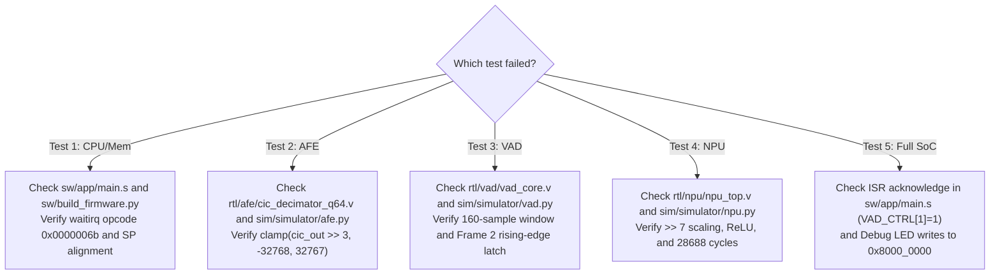

# Smartwatch SoC Regression Verification & Diagnostic Skill

This skill provides step-by-step instructions for running verification suites, analyzing simulation results, dumping waveforms, and methodically diagnosing test failures, adhering to [04_verification_and_acceptance_spec.md](../../../docs/spec/04_verification_and_acceptance_spec.md).

---

## 1. Five Mandatory Regression Testcases (Exit Criteria)

Every change must achieve **5/5 PASS (100% Bit-True Match)** on the test suite:

| # | Subsystem | Target Tested | Expected Verification Result |
|---|---|---|---|
| **1** | **CPU & Memory** | `PicoRV32`, ITCM, DTCM, `waitirq` | `[PASS] RISC-V RV32I 算術與自訂指令 (waitirq) 100% 正確` |
| **2** | **Audio Front-End** | 3-stage CIC decimator, Audio FIFO | `[PASS] CIC 濾波器降頻 PDM 串流 -> FIFO 樣本數: 10, 樣本值 = -194` |
| **3** | **Hardware VAD Core** | Short-time energy, hangover FSM, IRQ | `[PASS] 硬體 VAD 短時能量累加計算 100% 位元精確！`<br>`[PASS] 上升沿喚醒中斷 (irq_vad_wakeup) 於第 2 幀成功觸發！` |
| **4** | **KWS NPU Engine** | DS-CNN INT8 quantized inference | `[PASS] NPU DS-CNN 推論結果與 Python 黃金模型 100% 位元精確！`<br>`[PASS] 硬體執行延遲: 28688 週期 (2.33 ms @ 12.288MHz)`<br>`[PASS] 分類推論得分: Class 0 (背景雜音) = 58, Class 1 (喚醒詞) = -51` |
| **5** | **Full SoC Integration** | Boot $\to$ VAD Wakeup ISR $\to$ NPU | `[PASS] 階段 1: CPU 開機 -> 配置 AFE/VAD -> 進入待機休眠 (LED = 0x04)`<br>`[PASS] 階段 2: 偵測到語音串流 -> 觸發 VAD 喚醒中斷 -> CPU 執行 ISR`<br>`[PASS] 階段 3: 載入語音特徵矩陣 -> 完成 NPU 硬體推論 -> LED = 0x55` |

---

## 2. Command Execution Matrix

### 2.1 Standard One-Click Regression
```bash
python3 sim/run_simulator.py --mode regression
```
- Expected run time: $< 2$ seconds.
- Expected exit code: `0`.
- All 5 tests must display `[PASS]`.

### 2.2 Rebuilding Dependencies Before Regression
If assembly code or golden algorithms were changed:
```bash
# 1. Rebuild firmware hex
python3 sw/build_firmware.py sw/app/main.s sw/firmware.hex

# 2. Regenerate golden vectors
python3 sim/run_sim.py

# 3. Re-run regression
python3 sim/run_simulator.py --mode regression
```

### 2.3 Generating VCD Waveform & Web Dashboard
To generate digital waveforms for GTKWave and an interactive HTML report:
```bash
python3 sim/run_simulator.py --mode scenario --vcd sim/waves_soc.vcd --dashboard sim/simulator_dashboard.html
```

### 2.4 Interactive Simulator Console
For single-step PC tracing and register inspection:
```bash
python3 sim/run_simulator.py --mode interactive
```

---

## 3. Systematic Failure Diagnostics Matrix

When a test case fails, follow this decision matrix:



### Diagnostic Details by Test:
- **Test 1 Failed (CPU / Memory)**:
  - Did you run `python3 sw/build_firmware.py sw/app/main.s sw/firmware.hex`?
  - Verify opcode for `waitirq` is `.word 0x0000006b`.
  - Verify stack pointer `sp` is aligned to 16 bytes (`0x1000_1FF0`).
- **Test 2 Failed (AFE CIC & FIFO)**:
  - Verify 22-bit signed clamp equation: `clamp(cic_out >> 3, -32768, 32767)`.
  - Verify FIFO read pop behavior: reading `AFE_DATA` (`0x008`) must decrement count and pop sample.
- **Test 3 Failed (VAD Core & Wakeup IRQ)**:
  - Check frame energy in `model/golden_vectors/vad_golden.txt`.
  - Verify frame window length is exactly 160 samples.
  - Verify `irq_vad_wakeup` is asserted on Frame 2 and clears on write `1` to `VAD_CTRL[1]`.
- **Test 4 Failed (KWS NPU Inference)**:
  - Verify Conv layer requantization: `>> 7` and clamp to `[0, 127]`.
  - Verify total cycle count is exactly **28,688 cycles** (no extra pipeline stalls).
  - Verify output scores: `Class 0 = 58`, `Class 1 = -51`.
- **Test 5 Failed (Full SoC Integration)**:
  - Check whether the ISR in `sw/app/main.s` writes `1` to `VAD_CTRL[1]` to clear the interrupt.
  - Verify LED state transitions: Boot (`0x04`) $\to$ IRQ/Noise (`0x55`).
