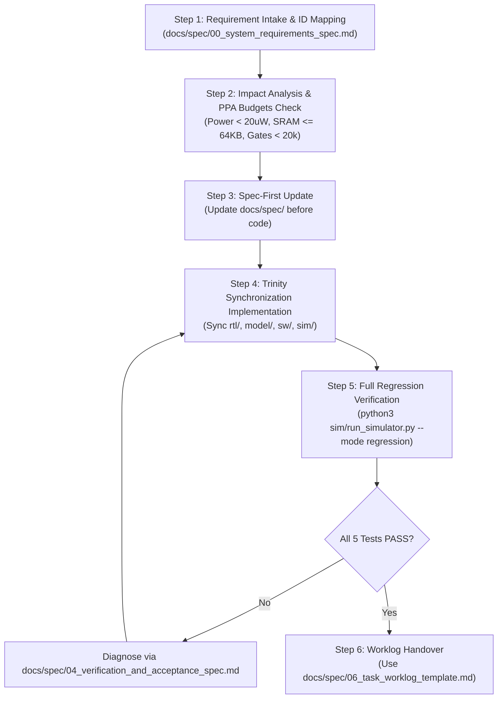

# Smartwatch SoC Spec-Driven Development (SDD) Workflow

This skill guides the agent through the complete Spec-Driven Development (SDD) lifecycle for the Smartwatch SoC project, adhering to the Single Source of Truth (SSOT) defined in `docs/spec/`.

---

## 1. The Core Commandments

Every task executed in this project **must** respect these 5 foundational invariants:

1. **Contract First (契約至上)**: Never invent register addresses, bit fields, or assembly instructions. Verify contracts in [01_hardware_interface_spec.md](../../../docs/spec/01_hardware_interface_spec.md) and [03_firmware_and_software_spec.md](../../../docs/spec/03_firmware_and_software_spec.md).
2. **Bit-True Invariance (位元精確)**: Algorithmic Python models (`model/`), digital RTL (`rtl/`), and cycle-accurate simulator (`sim/simulator/`) must match calculations with 100% bit-true accuracy (0 error).
3. **Resource Hard Budgets (資源約束)**:
   - Total on-chip SRAM $\le 64\text{ KB}$ (Default: 16 KB total: 8 KB Boot ROM + 8 KB Data RAM).
   - Zero external DRAM dependencies.
   - Standby power $< 20\text{ }\mu\text{W}$, logic gates $< 20\text{k}$ equivalent gates.
4. **Zero-Regression Gatekeeper (綠燈回歸交付)**: Before completing any task, execute:
   ```bash
   python3 sim/run_simulator.py --mode regression
   ```
   All 5 regression testcases must pass (100% PASS).
5. **Requirement Traceability (變更可追蹤性)**: Tag all modifications and commits with their respective requirement IDs (`REQ-SYS-*`, `REQ-BUS-*`, `REQ-ALG-*`, `REQ-FW-*`, `REQ-VERIF-*`).

---

## 2. Six-Step Standard Operating Procedure (SOP)



### Step 1: Requirement Intake & ID Mapping
- Inspect the user request and map it to the relevant requirement ID in:
  - System: [00_system_requirements_spec.md](../../../docs/spec/00_system_requirements_spec.md) (`REQ-SYS-*`)
  - Bus & Registers: [01_hardware_interface_spec.md](../../../docs/spec/01_hardware_interface_spec.md) (`REQ-BUS-*`)
  - Algorithm & Math: [02_algorithm_and_golden_model_spec.md](../../../docs/spec/02_algorithm_and_golden_model_spec.md) (`REQ-ALG-*`)
  - Firmware & ISR: [03_firmware_and_software_spec.md](../../../docs/spec/03_firmware_and_software_spec.md) (`REQ-FW-*`)
  - Verification: [04_verification_and_acceptance_spec.md](../../../docs/spec/04_verification_and_acceptance_spec.md) (`REQ-VERIF-*`)

### Step 2: Impact Analysis & Resource Check
- Assess impacts on:
  - Memory map (must fit within ITCM 8KB, DTCM 8KB, APB address space).
  - Gate count and PPA budget.
  - Latency targets (VAD frame $\le 10\text{ ms}$, KWS inference $< 15\text{ ms}$).

### Step 3: Spec-First Update (If Interface Changes)
- If introducing new registers, modifying bit fields, or changing algorithm equations:
  - Update [01_hardware_interface_spec.md](../../../docs/spec/01_hardware_interface_spec.md) or [02_algorithm_and_golden_model_spec.md](../../../docs/spec/02_algorithm_and_golden_model_spec.md) **before** writing code.

### Step 4: Trinity Synchronization Implementation
- Ensure all 4 project layers are updated synchronously:
  1. `model/`: Update Python DSP/quantization models and regenerate vectors via `python3 sim/run_sim.py`.
  2. `rtl/`: Update Verilog-2001 synthesizable modules (AFE, VAD, NPU, APB interconnect).
  3. `sw/`: Update `sw/include/soc_regs.h` and `sw/app/main.s`. Rebuild firmware:
     ```bash
     python3 sw/build_firmware.py sw/app/main.s sw/firmware.hex
     ```
  4. `sim/simulator/`: Update cycle-accurate behavioral models (`afe.py`, `vad.py`, `npu.py`, `soc.py`).

### Step 5: Verification & Zero-Regression Validation
- Run the full regression test suite:
  ```bash
  python3 sim/run_simulator.py --mode regression
  ```
- If any test fails, invoke `smartwatch-reg-test` or refer to the troubleshooting matrix in [04_verification_and_acceptance_spec.md](../../../docs/spec/04_verification_and_acceptance_spec.md#4-故障診斷手冊-failure-troubleshooting-matrix).

### Step 6: Structured Worklog Handover
- Present the final response following the structure of [06_task_worklog_template.md](../../../docs/spec/06_task_worklog_template.md), including:
  - Touched files with clickable markdown links (`file:///...`).
  - Requirement IDs (`REQ-xxx-yyy`).
  - Terminal output proof of `python3 sim/run_simulator.py --mode regression` (5/5 PASS).
  - Completed self-audit checklist.

---

## 3. The "NEVER" Prohibitions

- 🚫 **NEVER** complete a task without running `python3 sim/run_simulator.py --mode regression`.
- 🚫 **NEVER** add unregistered or unreviewed registers to APB3 map.
- 🚫 **NEVER** introduce floating-point math (`float`/`double`) into hardware RTL.
- 🚫 **NEVER** exceed 64 KB total SRAM or add external DRAM.
- 🚫 **NEVER** skip, comment out, or weaken assertions in regression tests.
- 🚫 **NEVER** allow `sw/include/soc_regs.h` and [01_hardware_interface_spec.md](../../../docs/spec/01_hardware_interface_spec.md) to become desynchronized.
