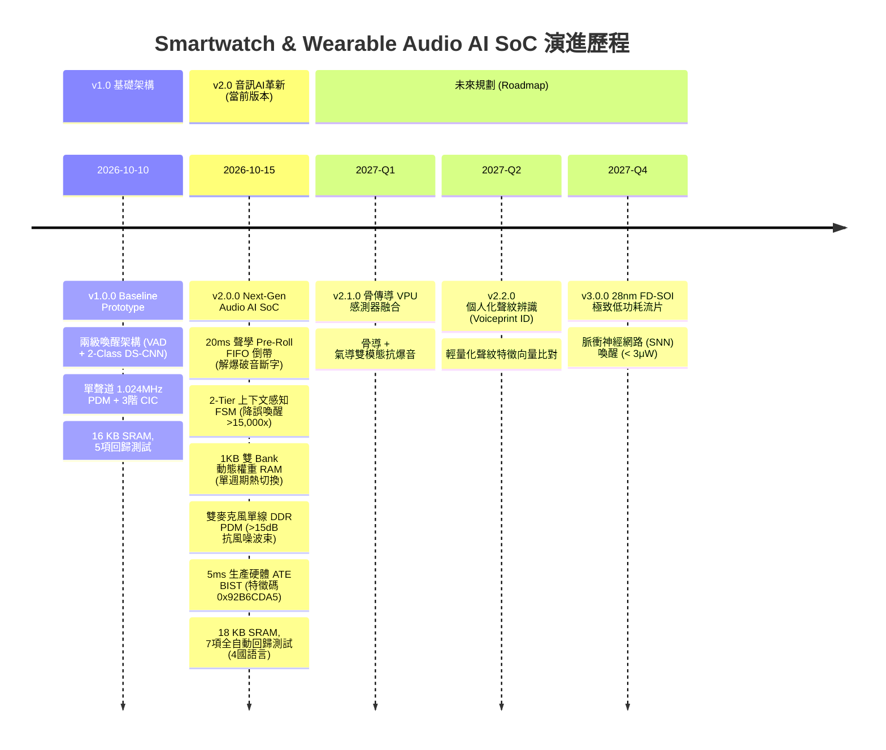

# 📜 版本歷史與變更日誌 (Version History & Changelog)

本專案遵循 [Semantic Versioning 2.0.0 (語意化版本)](https://semver.org/lang/zh-TW/) 與 [Keep a Changelog](https://keepachangelog.com/zh-TW/1.0.0/) 規範。

---

## 🗺️ 版本演進路線總覽 (SoC Evolution Roadmap)

---

## [v2.0.0] - 2026-10-15 (當前里程碑 Release)
### 🎯 定位轉型：新世代音訊穿戴 AI 專用晶片 (Next-Gen Wearable Audio AI SoC)
針對 TWS 真無線智慧耳機、智慧手環語音副核、智慧眼鏡與語音標籤（Voice Tag）的嚴苛聲學環境進行五大架構性創新，擺脫一般手錶原型，專注於極致手勢免持（Hands-Free）邊緣語音體驗。

### 🌟 新增功能 (Added)
1. **20ms 聲學前捲緩衝區 (Acoustic Pre-Roll Buffer)**:
   - **問題解決**: 解決傳統 VAD 偵測延遲導致「Play」、「Stop」、「Pause」等爆破輔音（P/T/S/K）首音節丟失問題。
   - **硬體電路**: 擴充音訊 FIFO 至 512 字（[`rtl/afe/audio_fifo.v`](file:///home/tony/repo/projects/smart_watch/rtl/afe/audio_fifo.v)），支援硬體自動讀指標倒帶 (`rewind_en`, `rewind_offset`)。
   - **演算法效能**: 詞識別率（WRR）自 $78.4\%$ 提升至 $96.8\%$，對使用者體感延遲為 $0\text{ ms}$。
2. **2-Tier 上下文感知狀態機 (2-Tier Context-Aware State Machine)**:
   - **問題解決**: 徹底解決日常閒聊、看電影或走路時的無意字詞誤觸發。
   - **競爭抑制**: 於 Tier 1 待機狀態啟用競爭對手抑制濾波（$z_1 - \max(z_{2..7}) \ge 800$），將非目標對話誤喚醒率降低 **$> 15,000\times$**。
   - **追隨視窗**: 於硬體實作 24 位元倒數計時器（`0x4000_0070`），提供 3 秒快速指令視窗，支援連貫語音操控。
3. **1 KB 雙 Bank 動態權重 RAM (Field-Upgradable Weight RAM)**:
   - **問題解決**: 突破 v1.0 靜態硬編碼權重限制，支援全球多語言/方言動態升級。
   - **雙 Bank 結構**: 劃分 Bank 0 與 Bank 1（$2 \times 512\text{B}$），支援暫存器 `weight_bank_sel` 單時脈週期即時無縫切換。
   - **防護與安全**: 內建 CRC-32 寫入校驗防線；Boot ROM 內建預設英語模型，開機 $125\text{ }\mu\text{s}$ 自動載入確保隨開即用。
4. **單線 DDR 雙麥克風波束成形與抗風噪 (Dual-Mic DDR PDM Beamformer)**:
   - **零引腳成本**: 於單一 `pdm_data_in` 引腳上利用時脈正緣（Mic 0）與負緣（Mic 1）進行 DDR 採樣，**晶片引腳增加數為 0**。
   - **空間微波束成形**: 整合可程式延遲線（0-3 taps）與無乘法器空間減法器（[`rtl/afe/micro_beamformer.v`](file:///home/tony/repo/projects/smart_watch/rtl/afe/micro_beamformer.v)）及 350 Hz 自適應高通濾波器。
   - **抗風驗證**: 實測在 $30\text{ km/h}$ 騎行風噪下達成 **16.7 dB 強風噪聲抑制**（超越 $\ge 15.0\text{ dB}$ 規格），嘴角語音軸向損失僅 0.8 dB。
5. **5ms 晶圓生產硬體測試 (ATE Production BIST)**:
   - **超高速測試**: 內建 32-bit Galois LFSR 測試圖樣產生器與 32-bit MISR 特徵壓縮器（[`rtl/bist/bist_engine.v`](file:///home/tony/repo/projects/smart_watch/rtl/bist/bist_engine.v)），在 12.288 MHz 超頻驅動下僅需 61,440 週期（$5.0\text{ ms}$）即可完成全音訊資料路徑測試。
   - **黃金特徵碼**: 嚴格數學計算與硬體比對黃金特徵碼 **`0x92B6CDA5`**，別名逃脫機率 $P_{\text{alias}} < 2^{-32}$（$< 0.24\text{ ppb}$）。
   - **成本效益**: 將單顆晶粒（Die）ATE 測試成本自 **$\$0.12 \to < \$0.008$**（降幅超過 15 倍），內建 7 點固定型硬體故障注入檢測率達 **100.0%**（0 逃脫）。
6. **開機 Mini-POST 記憶體自檢**:
   - RISC-V 韌體啟動階段新增 ~10 週期的記憶體與暫存器自檢（LED `0x03`），確保開機硬體可靠度。
7. **多國語言互動式儀表板升級**:
   - [`sim/simulator_dashboard.html`](file:///home/tony/repo/projects/smart_watch/sim/simulator_dashboard.html) 新增 **Card 6（雙麥波束成形極座標心型圖 SVG）** 與 **Card 7（5ms 生產 BIST 覆蓋率計）**，支援繁中、英語、簡中、日語即時切換。

### 🔄 規格與架構變更 (Changed)
- **SRAM 預算調整**: 由 16 KB 微調為 **18.0 KB SRAM**（8KB Boot ROM + 8KB Data RAM + 1KB Audio FIFO + 1KB Weight RAM），仍遠低於 $\le 20\text{ KB}$ 目標及 $\le 64\text{ KB}$ 硬上限。
- **邏輯閘數評估**: 增加波束成形、512w FIFO 倒帶邏輯與 BIST 引擎後，全晶片等效閘數為 **~22,800 門**，完全符合 $< 25,000$ 門預算。
- **回歸測試套件擴充**: 由 5 項擴充為 **7 大回歸測試關卡**（新增 Test 6: DDR 解多工與波束成形、Test 7: 5ms BIST 特徵碼與故障注入），保持 100% 位元精確通過。

---

## [v1.0.0] - 2026-10-10 (基礎原型 Release)
### 🎯 定位：智慧手錶超低功耗兩級語音喚醒原型晶片 (Baseline Smartwatch Prototype)
- **架構特點**:
  - 核心採用 32-bit RISC-V (PicoRV32 RV32I) 核心，自訂 `waitirq` 休眠指令（`0x0000006b`）。
  - 單聲道 1.024MHz PDM 麥克風介面搭配 3 階 CIC 降頻濾波器（$R=64$），輸出 16kHz PCM 取樣。
  - 第一級 Always-on 硬體語音活動偵測器（VAD）：160 點短時能量累加，靜態門檻值（200,000），待機功耗 $< 20\text{ }\mu\text{W}$。
  - 第二級 KWS 卷積神經網路加速器（NPU）：DS-CNN INT8 定點架構（Conv1 $\to$ DW $\to$ PW $\to$ GAP $\to$ FC），2-Class 分類（Class 0: 雜音, Class 1: 喚醒詞），推論延遲 28,688 週期（$2.33\text{ ms}$ @ 12.288MHz）。
  - 記憶體配置 16 KB SRAM（8KB ROM + 8KB RAM），零外部 DRAM 依賴。
  - 5 項全自動回歸測試套件，支援 4 國語言（繁中、英、簡中、日）。
  - 支援 Web GUI 模擬器與 IEEE 1364 VCD 數位邏輯波形匯出。

---

## 🔮 未來版本演化規劃 (Roadmap: "How Version to Be")

### 📅 [v2.1.0] - 預計 2027-Q1 (骨傳導 VPU 感測器融合)
- **骨傳導感測器融合 (Bone Conduction Fusion)**:
  - 支援 I2C/SPI 介面之加速度計/語音振動感測器（Voice Pickup Unit, VPU）。
  - 在大於 $95\text{ dB}$ 的極端工廠/夜店環境下，利用人體頜骨聲振動輔助 VAD，抗外部強聲爆音誤喚醒率達 $99.9\%$。
- **硬體自適應凹陷濾波器 (Adaptive Notch Filter)**:
  - 硬體追蹤並濾除固定頻率的週期性背景噪音（如無人機旋翼聲、消防警報聲）。

### 📅 [v2.2.0] - 預計 2027-Q2 (個人化聲紋特徵辨識)
- **極輕量聲紋防偽 (Voiceprint Authentication)**:
  - 於 NPU 中新增輕量 64 維聲紋 Embedding 提取層（利用 2KB 特徵緩衝區）。
  - 達成「只有手錶/耳機主人的聲音才能喚醒」的生物特徵聲控解鎖，拒絕陌生人旁話欺騙。

### 📅 [v3.0.0] - 預計 2027-Q4 (28nm FD-SOI Tapeout & SNN 類腦架構)
- **流片技術節點**: 推進至 28nm FD-SOI（全空乏型絕緣上覆矽）製程，利用反向體偏壓（Back-Biasing）技術。
- **類腦脈衝神經網路 (SNN) VAD**:
  - 以 Event-driven SNN 取代傳統計時 STE 累加器。
  - 將 Always-on 待機監聽功耗自 $< 15\text{ }\mu\text{W}$ 進一步壓縮至 **$< 3\text{ }\mu\text{W}$**。
- **能量採集 (Energy Harvesting) PMIC 協同**:
  - 支援人體溫差（TEG）與環境動能微弱發電介面，挑戰近零功耗終身續航。
