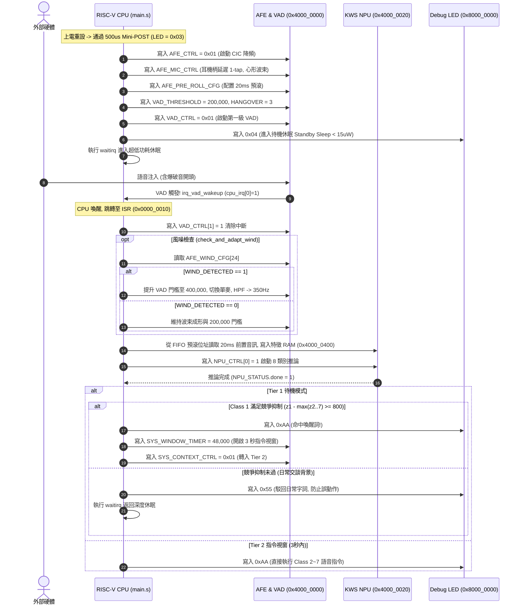

# 03 - 韌體與軟體架構規範書 (Firmware and Software Specification, SWS)

[繁體中文](03_firmware_and_software_spec.md) | [English](en/03_firmware_and_software_spec.md)

規格文件編號：`SPEC-SWS-001`  
版本：`2.0.0`  
狀態：`Approved / SSOT`

---

## 1. 處理器核心架構規範 (CPU Core Specification)

系統控制大腦採用 32-bit RISC-V 處理器核心（PicoRV32）：
- **指令集架構 (ISA)**：標準 **RV32I** 整數指令集。
- **硬體功能配置**：
  - 具備 32 顆 32-bit 通用整數暫存器（`x0` ~ `x31`，支援 ABI 別名）。
  - 支援硬體桶形移位器 (Barrel Shifter)。
  - 支援計數器暫存器 (`RDCYCLE`, `RDTIME`, `RDINSTRET`)。
- **低功耗客製指令 (Custom Instruction)**：
  - **`waitirq`**：機器碼為 `.word 0x0000006b`。
  - 功能：使 CPU 立即暫停指令解碼與執行，凍結管線並進入超低功耗休眠，直到任意硬體中斷線（`cpu_irq != 0`）被拉高為止。休眠恢復時間 $< 1\text{ 週期}$（$0\text{ }\mu\text{s}$ 開銷）。

---

## 2. 記憶體佈局與向量表 (Memory Layout & Vector Table)

```
0x0000_0000 ┌──────────────────────────────────────┐
            │ 重設向量入口 (Reset Vector Entry)     │ -> j _start
0x0000_0004 │ 保留/未用空間                         │
0x0000_0010 ├──────────────────────────────────────┤
            │ 中斷陷阱入口 (Trap/ISR Vector Entry)   │ -> j _isr_handler
0x0000_0014 │ 韌體程式碼段 (.text)                  │
            │ Mini-POST 自檢常式 (500us)            │
            │ 常數資料段 (.rodata)                 │
            │ 出廠預設英文喚醒權重模型 (292B)        │
0x0000_1FFF └──────────────────────────────────────┘ (8 KB ITCM / Boot ROM)

0x1000_0000 ┌──────────────────────────────────────┐
            │ 全域變數段 (.data / .bss)             │
            │ g_wind_state (0x1000_0004, 4B)       │
            │ 特徵快取緩衝區 (Audio Frame Buffer)   │
            │                ▼                     │ (堆疊向下增長)
0x1000_1FF0 │ 初始堆疊指針 (Initial Stack Pointer)  │ (SP = 0x1000_1FF0)
0x1000_1FFF └──────────────────────────────────────┘ (8 KB DTCM / Data RAM)
```

---

## 3. 韌體開機、POST 自檢與主迴圈狀態流程 (Boot, POST & Main Flow)

韌體原始碼位於 [`sw/app/main.s`](file:///home/tony/repo/projects/smart_watch/sw/app/main.s)。

### 3.1 開機模式辨別與硬體自檢 (POST vs ATE BIST)
1. **上電復位 (POR)**：CPU 初始 SP = `0x1000_1FF0`，LED 置位 `0x01` (Booting)。
2. **硬體 Strap 判斷**：讀取 `REG_SYS_STRAP[0]` (`0x4000_0070`)：
   - **若 `TEST_STRAP == 1` (ATE 晶圓探針扎片)**：
     - LED 輸出 `0x05` (ATE BIST Active)。
     - 觸發 5ms 完整硬體 BIST，覆蓋 AFE、VAD、NPU 及 SRAM。
     - 若 MISR 匹配 `0x92B6CDA5`，輸出 LED = `0xAA`，保持 `soc_trap = 0` (Bin 1 PASS)；若失敗則根據故障區塊輸出 `0xE1`~`0xE4` 並拉高 `soc_trap = 1`。
   - **若 `TEST_STRAP == 0` (正常電池開機)**：
     - LED 輸出 `0x03` (Mini-POST Active)。
     - 執行 $500\text{ }\mu\text{s}$ 輕量自檢常式（耗能僅 $2.0\text{ }\mu\text{J}$），確認無死鎖缺陷後通過。

### 3.2 執行與中斷服務序列 (Runtime Flow)



---

## 4. 除錯 LED 狀態編碼規範 (Debug LED State Codes)

寫入記憶體位址 `0x8000_0000` 之 8-bit LED 狀態碼定義如下：

| LED 數值 (Hex) | 二進位顯示 | 系統目前狀態 | 意義與說明 |
|---|---|---|---|
| `0x00` | `0000_0000` | **Power-On Reset** | 剛重設完成，CPU 尚未開始執行初始化 |
| `0x01` | `0000_0001` | **Booting** | 正在執行韌體初始化常式 |
| `0x02` | `0000_0010` | **Configured** | 音訊前端、預滾與 VAD 門檻設定完畢 |
| `0x03` | `0000_0011` | **Mini-POST Active** | 正在執行開機 $500\text{ }\mu\text{s}$ 硬體安全自檢 |
| `0x04` | `0000_0100` | **Standby Sleep** | 進入深度休眠，Always-on 待機（功耗 $< 15\text{ }\mu\text{W}$） |
| `0x05` | `0000_0101` | **ATE BIST Active** | 正在執行 5ms 生產晶圓掃描測試 |
| `0x55` | `0101_0101` | **Feature Load / Rejected** | 載入特徵或因競爭抑制駁回日常對話誤喚醒 |
| `0xAA` | `1010_1010` | **Keyword Hit / BIST Pass** | 成功命中喚醒詞或 BIST 簽名驗證 100% 合格 |
| `0xE1` | `1110_0001` | **Fault: SRAM Error** | ITCM/DTCM 記憶體邊界檢查失敗 |
| `0xE2` | `1110_0010` | **Fault: AFE CIC Error** | CIC 降頻濾波器或預滾緩衝故障 |
| `0xE3` | `1110_0011` | **Fault: VAD Error** | VAD 短時能量累加器故障 |
| `0xE4` | `1110_0100` | **Fault: NPU Error** | NPU MAC 陣列或權重 RAM 故障 |
| `0xEF` | `1110_1111` | **Fault: MISR Mismatch** | 生產 BIST 簽名碼不符合 `0x92B6CDA5` |
| `0xFF` | `1111_1111` | **System Trap** | 發生非預期例外或硬體死當 |

---

## 5. 韌體編譯與組譯工具鏈規格 (Assembler Toolchain)

專案內建純 Python 編寫的輕量級 RISC-V 組譯器 [`sw/build_firmware.py`](file:///home/tony/repo/projects/smart_watch/sw/build_firmware.py)。

### 5.1 執行指令
```bash
python3 sw/build_firmware.py sw/app/main.s sw/firmware.hex
```

### 5.2 支援指令清單
- **運算類 (R-Type / I-Type)**：`ADD`, `ADDI`, `SUB`, `AND`, `ANDI`, `OR`, `ORI`, `XOR`, `XORI`, `SLL`, `SLLI`, `SRL`, `SRLI`, `SRA`, `SRAI`, `SLT`, `SLTI`
- **高位立即數 (U-Type)**：`LUI`, `AUIPC`
- **記憶體存取 (Load / Store)**：`LW`, `SW`, `LH`, `SH`, `LB`, `SB`, `LBU`, `LHU`
- **分支與跳轉 (B-Type / J-Type)**：`BEQ`, `BNE`, `BLT`, `BGE`, `BLTU`, `BGEU`, `JAL`, `JALR`
- **偽指令 (Pseudo Ops)**：`NOP`, `LI`, `LA`, `MV`, `J`, `JR`, `RET`
- **客製休眠指令**：`.word 0x0000006b` (`waitirq`)

---

## 6. 軟體需求追蹤清單 (Traceability Requirements)

| 需求 ID | 技術驗證標的 |
|---|---|
| `REQ-FW-001` | 開機初始重設向量必須位於 `0x0000_0000`，中斷陷阱向量位於 `0x0000_0010`。 |
| `REQ-FW-002` | 堆疊指針 SP 初始值必須設定於 `0x1000_1FF0`。 |
| `REQ-FW-003` | 進入待機前，必須依序配置 `AFE_CTRL`、`AFE_MIC_CTRL`、`AFE_PRE_ROLL_CFG`、`VAD_THRESHOLD` 與 `VAD_CTRL`。 |
| `REQ-FW-004` | 必須使用 `waitirq` 進入低功耗休眠，並在進入時將 LED 更新為 `0x04`。 |
| `REQ-FW-005` | VAD 中斷觸發後，ISR 必須明確寫入 `VAD_CTRL[1] = 1` 完成清除。 |
| `REQ-FW-006` | 分類決策若為目標喚醒詞，LED 必須輸出 `0xAA`；若非喚醒詞則更新為 `0x55` 並返回休眠。 |
| `REQ-FW-007` | 開機必須採樣 `REG_SYS_STRAP[0]`，區別 5ms ATE BIST 與 500us Mini-POST。 |
| `REQ-FW-008` | Mini-POST 執行時間嚴格小於 6,144 週期 ($500\text{ }\mu\text{s}$)，耗能 $\le 2.0\text{ }\mu\text{J}$。 |
| `REQ-FW-009` | 偵測到強風 (`WIND_DETECTED=1`) 時，韌體需在 70 拍內完成門檻倍增與波束旁路。 |
| `REQ-FW-010` | 支援 2-Tier 上下文過濾，Tier 1 嚴格執行 $z_1 - \max(z_{2..7}) \ge 800$ 判定。 |
| `REQ-FW-011` | 支援 UART 模型下載 CRC 驗證，並在開機時自 Boot ROM 載入出廠模型。 |
| `REQ-FW-012` | 發生硬體故障時，必須在 `debug_leds` 輸出對應的子模組故障代碼 (`0xE1`~`0xE4`)。 |

